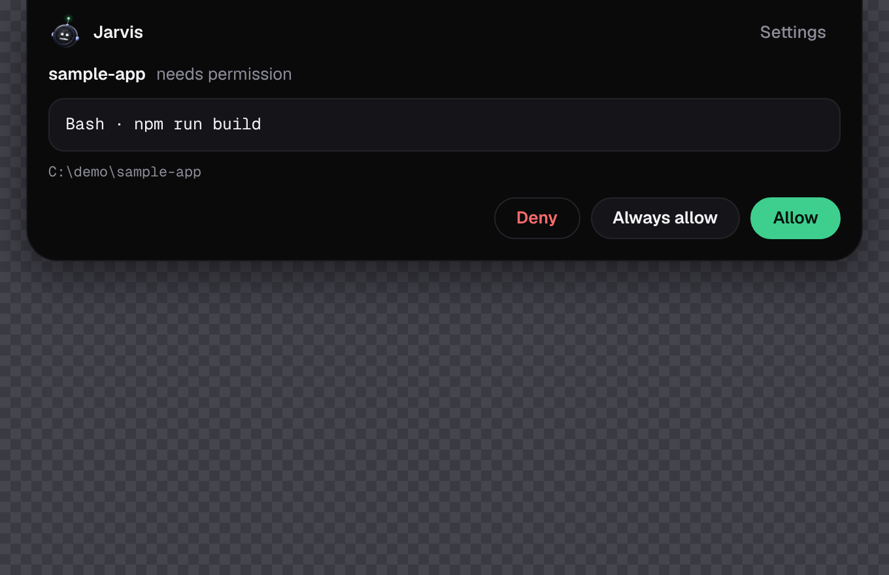
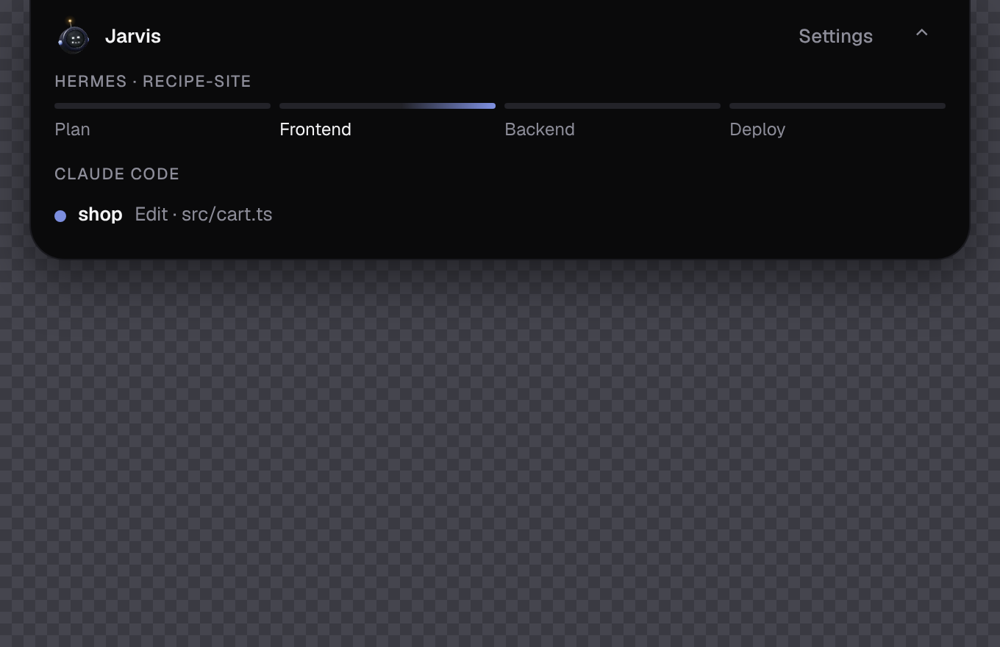
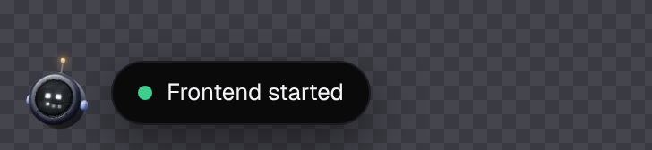

# Jarvis Island (Windows)

A small island at the top of your screen. It stays hidden until something needs
you: a Claude Code permission request (**Allow / Deny / Always allow**), a
question Claude Code asks, or a Hermes plan waiting for approval. It also shows
your Claude Code sessions and the Hermes stages (plan → frontend → backend →
deploy) while they run.

It is a clean-room design inspired by [Lintel](https://lintel.thisissbk.com/)
(see [the research notes](research/lintel-reverse-engineering.md)); no Lintel code is used.

## The look

A near-black island with a soft periwinkle accent and Geist type, in the spirit of
Lintel. The mascot is a small robot head from the MIT-licensed
[robot-heads](https://github.com/fayazara/robot-heads) library, with an LED face
that shows what is going on: **listening** while a card waits for you, **working**
while Claude Code works, **thinking** while a Hermes stage runs, **happy** after
an approval or a finished turn, **error** after a denial or failure, and
**sleeping** after ten idle minutes.




**Two places to live.** By default it hangs from the top edge of the screen. Drag
it down and it becomes a floating ball you can park anywhere; click the ball to
open the panel next to it. Drop the ball near the top edge, or choose
*Put the island back at the top* from the tray menu, to dock it again. It
remembers where you left it.



**Light on a slow PC.** The robot is *Lite* by default: its frames are recorded
ahead of time and played as a sprite, so the page runs no script per frame. Measured
in headless Chromium without a GPU (a worst case) over 10 s: about 0.1 % of one
core for an idle page, 0.6 % with a still robot, **2 % in Lite**, and 15 % in
*Live 3D* (the real renderer, capped at 20 fps, eyes follow your pointer). Switch
between *Lite*, *Live 3D* and *Off* in Settings. Hidden, nothing runs at all.

**Sounds** (a rising chime for a new card, a ping when something finishes, a low
tone on a denial) are off until you turn them on in Settings.

## Install

1. Open the repository's **Actions** tab → **Island** workflow → the latest green
   run → download the **jarvis-island-installer** artifact and unzip it.
2. Run `Jarvis Island_0.1.0_x64-setup.exe`. It installs for your account only
   (no administrator rights). Windows SmartScreen may warn because the installer
   is not code-signed yet: **More info → Run anyway**.
3. Start **Jarvis Island** from the Start menu. A thin bar appears at the top
   centre of your main display; point at it and the island slides out. The app
   also has a tray icon (right-click → *Claude Code hooks…*, *Quit*).

## Connect Claude Code

1. Point at the island, open it, and click **Settings** (or tray → *Settings…*) → *Claude Code hooks*.
2. Click **Install…**. The island shows exactly what it will change in
   `%USERPROFILE%\.claude\settings.json`, as a diff. Nothing is written yet.
3. Click **Write changes**. The previous file is backed up next to it
   (`settings.json.jarvis-backup-<time>`). Other hooks you have are kept.
4. New Claude Code sessions now send their permission requests to the island.

**Remove…** in the same place takes our entries out again and leaves everything else alone.

### What happens when…

| Situation | Result |
|---|---|
| You click **Allow** / **Deny** | Claude Code continues / is told "Denied from Jarvis Island". |
| You click **Always allow** | Allowed, and Claude Code saves its suggested rule so it stops asking. |
| Nobody answers within ~110 s | The island lets go; Claude Code asks in its terminal as usual. |
| The island is not running | The hook exits immediately; nothing changes for Claude Code. |
| Under `claude -p` (Hermes) with no answer | Claude Code denies the request, so nothing runs unapproved. |

## Use it with Hermes

Run Hermes as usual (`npm run hermes -- "a site about …"`). With the island running:

- each stage shows on the island as it starts and finishes;
- when the plan is ready, the island shows **Approve plan / Request changes**.
  The terminal prompt is still there, and whichever you answer first wins;
- Hermes runs Claude Code with `claude -p`, so every permission request
  (pushes, deploys, Supabase writes, browser actions) becomes an island card.
  Set `HERMES_PERMISSION_MODE=default` in `.env` to approve file edits there too.

## Build it yourself (optional)

Needs Windows 10/11, [Node.js 22](https://nodejs.org/), [Rust](https://rustup.rs/)
and the WebView2 runtime (already on Windows 11).

```powershell
cd island
npm install
npm run tauri dev      # run from source
npm run tauri build    # installer in island\target\release\bundle\nsis\
```

## How it works

```
Claude Code ──spawns──▶ jarvis-hook.exe ──one JSON line──▶ \\.\pipe\jarvis-island-<user>
                              ▲                                     │
                              └──── {"decision":"allow"} ◀── island card ◀── you click
Hermes (src/island.js) ──────────── same pipe, same protocol ───────┘
```

- `island/hook` is the relay Claude Code runs on each hook event. It never holds
  Claude Code up: 300 ms to connect, 2 s total for ordinary events, and only
  `PermissionRequest` waits for a click.
- `island/protocol` is the shared logic: the wire format, Claude Code's reply
  JSON, the settings.json merge, and the relay server. The server checks a
  random token the app writes to `%LOCALAPPDATA%\jarvis-island\token` at start,
  and declines a request unless the island confirms the card is on screen within 800 ms.
- `island/src-tauri` is the Tauri 2 app. It owns the topmost, non-focusable window
  that lets clicks through everywhere except over the island.
- `island/src` is the page (plain TypeScript): hidden → peek → open, the cards, the robot (`mascot/`) and the placement rules (`place.ts`).
- `island/src/vendor/robot-heads` is the robot renderer (MIT, Fayaz Ahmed), copied unchanged; `island/scripts/bake-robot.mjs` records the Lite sprites from it (`public/robot/`), and `island/scripts/preview.mjs` renders screenshots and measures CPU.

Tests: `cargo test -p jarvis-island-protocol --features server`, `cargo test -p jarvis-hook`
(the real hook against the real server), `npm test` in `island/` and at the repo root.
CI runs all of them on Linux and Windows, builds the installer, and runs
`island/scripts/smoke.ps1` against the built app on a Windows runner. It uploads
screenshots of the island with a live card.
